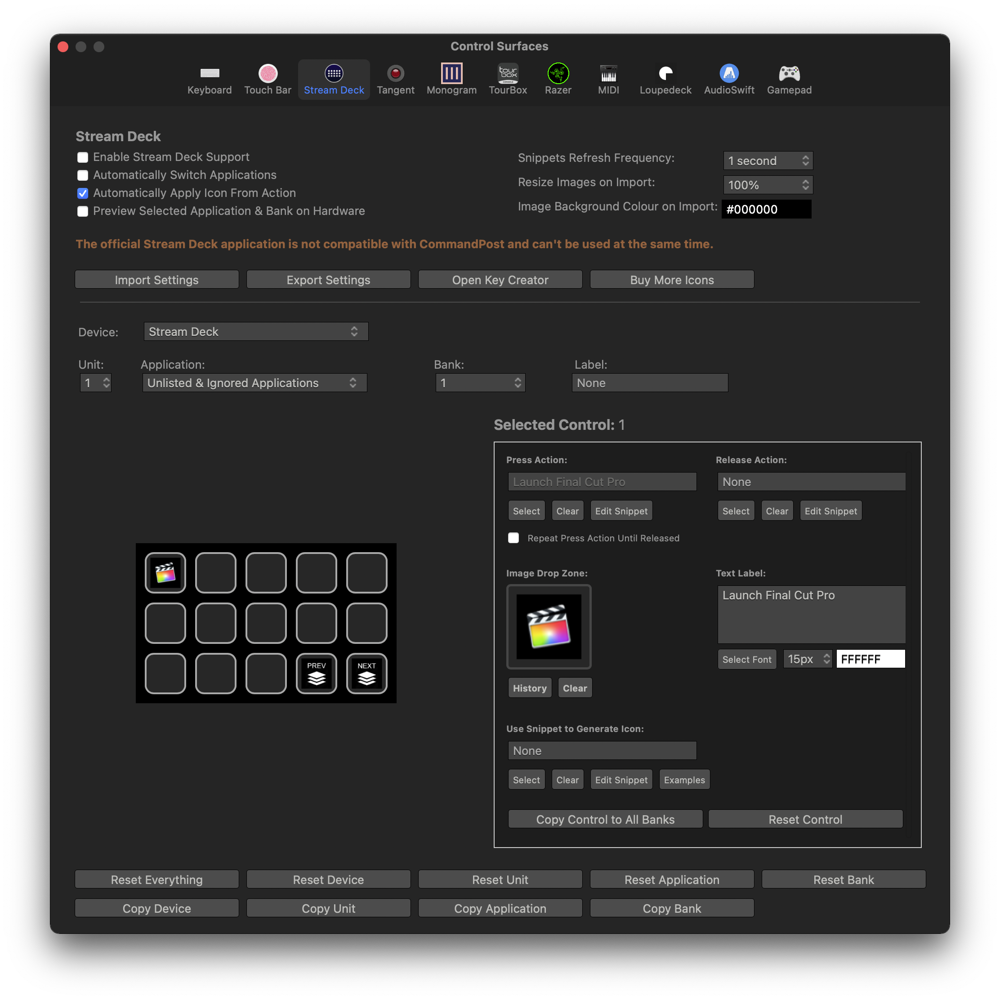

# Stream Deck

CommandPost currently supports the following Stream Deck devices:

- [Stream Deck](https://www.elgato.com/en/gaming/stream-deck)
- [Stream Deck XL](https://www.elgato.com/en/gaming/stream-deck)
- [Stream Deck Mini](https://www.elgato.com/en/gaming/stream-deck)
- [Stream Deck Plus](https://www.elgato.com/en/gaming/stream-deck)

If you have a [Stream Deck](https://www.elgato.com/en/gaming/stream-deck) device, you can assign any action within CommandPost to a Stream Deck button via the Preferences screen:

---

