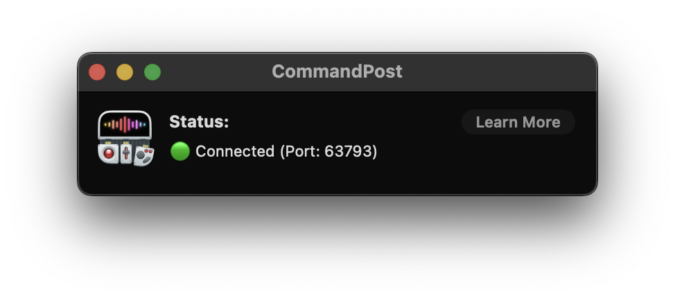
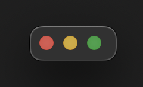

# Workflow Extension

The CommandPost Workflow Extension allows CommandPost to control the Final Cut Pro playhead via the Workflow Extensions API.

CommandPost will automatically attempt to launch the Workflow Extension if you trigger an action that uses it.

Currently the Workflow Extension is basically just a helper tool - it has no useable user interface.

Because of this, you can resize the window to make it as small as possible, and drag it off-screen.

We don't currently have any plans to add any features to the Workflow Extension as we already have the CommandPost HUD, which offers similar functionality in a more streamlined user interface.

If you have any ideas or suggestions on how we could enhance the Workflow Extension, [let us know](https://github.com/CommandPost/CommandPost/issues).

---

