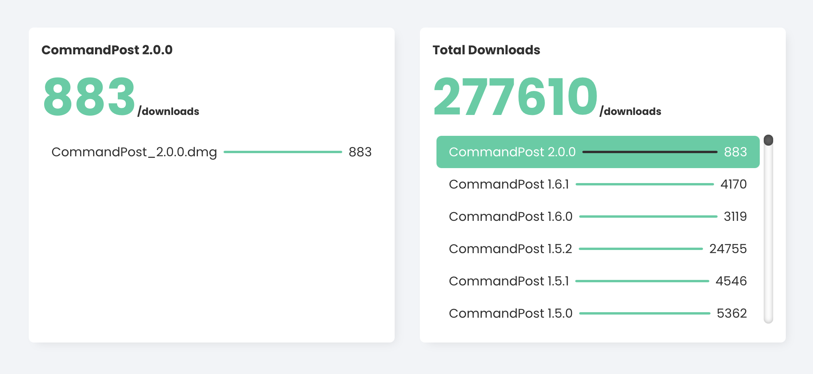
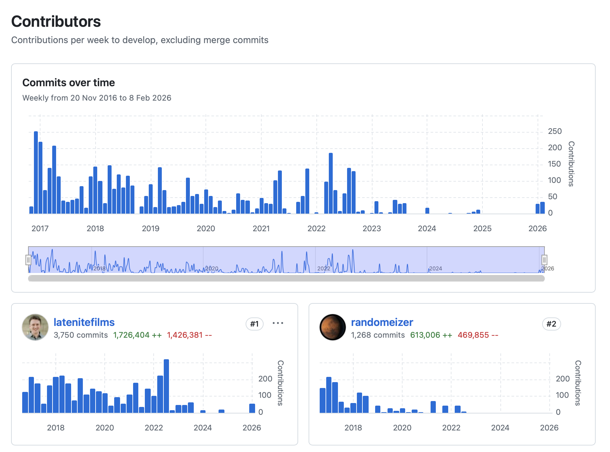
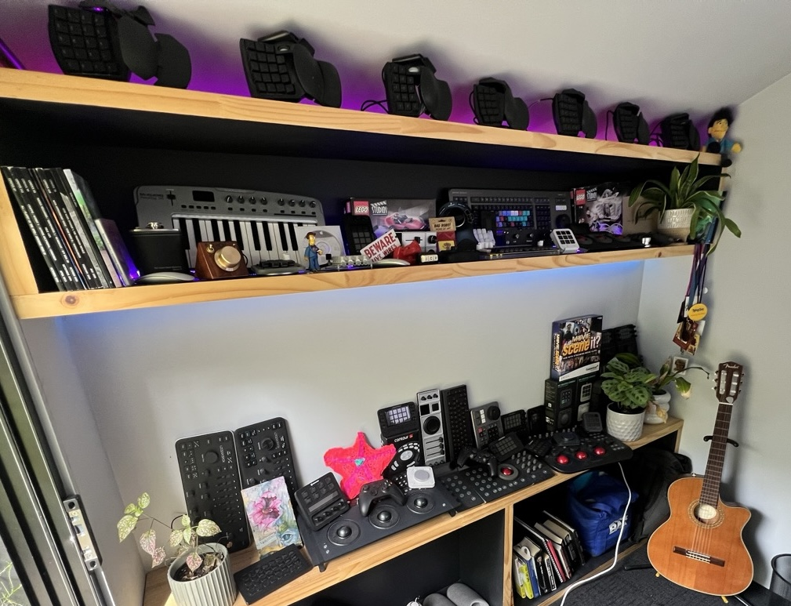

# Frequently Asked Questions

### Why CommandPost v3?

Back in 2016, **FCPX Hacks** was created by [Chris Hocking](https://fcp.cafe/latenite/#chris-hocking) as a proof-of-concept to make finding the Final Cut Pro browser playhead easier for [Scott Simmons](http://www.scottsimmons.tv/).

You can read the origin story on [FCP Cafe](https://latenitefilms.com/blog/final-cut-pro-hacks/).

It was later renamed to **CommandPost** after I teamed up with David Peterson.

Over the last decade, CommandPost has grown and evolved - adding thousands of features, and supporting thousands of users.

It's been used for projects at **Netflix**, **Pixar** and the **BBC**. People at companies such as **Apple**, **Avid** and **Adobe** use it daily.

All of the 2024-2026 **Apple Worldwide Developer Conference (WWDC)** videos were graded using Tangent panels in Final Cut Pro controlled by CommandPost v2. 🥳

**CommandPost v2** has continuously updated since 2016 - as you can see in the [release notes](/commandpost-v2/release-notes/).

A lot of the features and functionality that went into CommandPost v2 has been merged back into [Hammerspoon](https://www.hammerspoon.org), which is the engine that drives CommandPost v2.

Back on 15th September 2016, I wrote:

> Over the last few days, I’ve been having lots of discussions with other Final Cut Pro users on social media about how annoying the **Reveal in Browser** (aka "Match Frame") feature in FCPX is. The problem is that if you have hundreds of clips within your browser, when you match frame it’s really hard to instantly visually see where the playhead is in a sea of other clips. It’s also really annoying if you’ve got your playhead at a specific position in the browser, then continue editing in the timeline for a hour or so, and want to easily jump back to that browser playhead position to continue where you left off. It’s VERY hard to spot which clip is selected and where the tiny white playhead is hiding in the browser!

Basically, I really wanted to solve this problem for [Scott Simmons](https://www.scottsimmons.tv), and I couldn't solve it with AppleScript or Automator (and at the time I had ZERO idea about Xcode), but I found a little open source project called [Hammerspoon](https://www.hammerspoon.org), and kinda fell in love.

I grew up with BASIC programming on a PC, and Lua (the scripting language used in Hammerspoon) was VERY similar.

Once I solved the **Highlight Playhead** problem, I started tackling hundreds of other Final Cut Pro Workflow issues.

Eventually **FCPX Hacks** became a monster with hundreds of features. You can read about it on [this old blog post](https://fcp.cafe/blog/final-cut-pro-hacks/#final-cut-pro-hacks).

As **FCPX Hacks** grew though, something awesome happened. A Brisbane guy called David Peterson got in touch. He was a filmmaker, but also a professional programmer, and he had some ideas on how to fix up **FCPX Hacks** to make it better.

We started collaborating... a lot. He introduced me to [GitHub](https://github.com). He slowly helped me transform my GIANT single Lua file (that was **FCPX Hacks**) into **many** individual files.

Eventually, we decided, rather than just shipping a bunch of Lua scripts, and asking users to install Hammerspoon - we forked Hammerspoon, renamed **FCPX Hacks** to **CommandPost**, and started shipping it as a self-contained application.

In **November 2019**, after **78 releases** of **FCPX Hacks** and **91 beta releases** of CommandPost, CommandPost v1.0.0 was released into the world.

At the time, with over 3300 active monthly users and over 1208 users in our Facebook Community, we were very happy with the progress CommandPost had made over the previous three years.

Over the next 7 years, we continued to update CommandPost and make it bigger and better.

More control surfaces were added. Every time Apple pushed out a Final Cut Pro update, we had to madly work to support it on launch day.

Apple has never given us access to early copies/betas/seeds of Final Cut Pro - so we get our hands on it the same day that you do - and generally speaking something breaks, because a user interface has changed, a button has been renamed, or the `FCPXML DTD` has been updated.

Whilst there were some amazing companies like Tangent and Loupedeck who have been INCREDIBLY supportive of CommandPost, for most control surface companies, they didn't really care about CommandPost, so we had to buy our own hardware to make things work.

Over the years both David and I have spent an insane amount of hours on CommandPost, especially in the early days:

We've also spent a LOT of money on control surfaces out of our own pockets.

Whilst we've always offered a way to sponsor CommandPost on GitHub, very few took up the opportunity.

At the time of writing, the CommandPost GitHub repository currently has 9 sponsors, and my personal GitHub repository currently has 3 sponsors.

The GitHub income barely covers the cost of the domain, let alone buying control surfaces for testing.

The hope/dream had always been to get CommandPost onto the Mac App Store, but unfortunately the Mac App Store doesn't allow any applications that use Private APIs or applications that use the Accessibility API.

I spent a few months trying to get something onto the Mac App Store - but just hit road-block after road-block, so in the end I decided to come up with another plan.

Building out our own licensing system, and online shop was definitely an option, but I helped do that for [Jumper](https://getjumper.io), and it was a HUGE amount of work, and there's an on-going cost for Paddle & Keygen. Basically, this just all falls into the too hard basket, so I came up with something a bit more unique...

For **CommandPost v2**, we introduced a pay-wall of sorts...

**CommandPost v2** requires at least **ONE PAID** [LateNite](https://apps.apple.com/au/developer/latenite-films-pty-ltd/id1652018641) application installed.

Consider it "inner circle" software (i.e. only our mates get access to it).

The hope/plan was that lots of people would buy my apps, and I'd be able to spend more time working on CommandPost - but, it never really worked out like that.

All the apps I build are pretty niche, and none of them are really mainstream, so there's never been enough income to set aside serious time on CommandPost.

In 2026, the world changed... LLMs got CRAZY good. Now ANYONE can build ANYTHING. It's insane.

What's been super interesting is that people seem interested and keen to make LLMs to INSANE things with [SpliceKit](https://splicekit.fcp.cafe).

However, no one seems to be willing to use LLMs to improve CommandPost v2. We pretty much never get a pull request.

The open source model for CommandPost has never really worked.

And Hammerspoon is now evolving too... dumping Lua for JavaScript.

So... after lots of contemplation, I decided to throw everything away, and start from scratch - and re-write and re-design CommandPost v3 to be the app I always imagined.

It's a MASSIVE undertaking, but to be honest... I've done it all before with CommandPost v2, so I kinda know all the things I need to know.

I decided to make CommandPost v3 closed source, because there's now so much vibe coded stuff that uses CommandPost for reference.

If people aren't going to contribute to CommandPost's code - I'd rather just keep things simple, and keep it closed.

It also means I don't need to worry as much about making sure the repo is in good order, with good comments, etc as it's really just for me to navigate.

---

### Why the Mac App Store?

Because it's simple and easy for end users.

---

### Can I keep CommandPost v2?

Yes, simply rename the original `CommandPost.app` to `CommandPost v2.app` in Finder.

---

### Do I need to redo all my control surface layouts?

Yes, CommandPost v3 is a complete re-write and re-design, so you'll need to re-do all your layouts.

---

