# CommandPost v3

!!!warning Coming soon!
We're currently testing **CommandPost v3** on TestFlight and are awaiting Apple's approval for the Mac App Store!
!!!

**The Swiss Army Knife for Post Production Professionals**

**CommandPost v3** is a insanely powerful macOS application that makes your post production and editing life **faster** and **lots more fun** (everything is better with more buttons!). 🎛️

[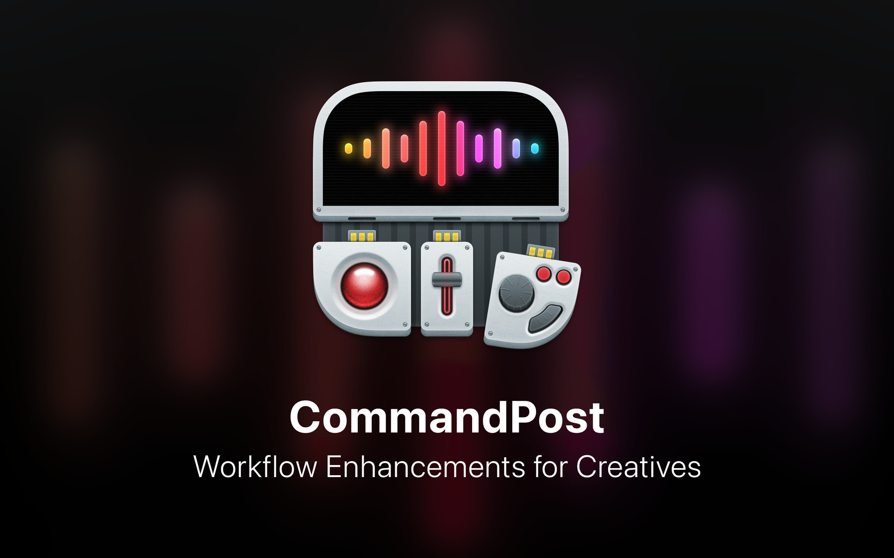](/static/commandpost-logo.png "View the full-resolution CommandPost artwork")

This isn't some new vibe-coded... thing. It's grown over the last **decade**, based on feedback from industry professionals.

It's been used for projects at **Netflix**, **Pixar** and the **BBC**. People at companies such as **Apple**, **Avid** and **Adobe** use it daily.

All of the 2024-2026 **Apple Worldwide Developer Conference (WWDC)** videos were graded using Tangent panels in Final Cut Pro controlled by CommandPost v2. 🥳

**CommandPost v3** has been written in Swift and SwiftUI, and optimised for modern Apple Silicon Mac's.

It adds **tens of thousands** of actions for Apple’s [Final Cut Pro](https://www.apple.com/final-cut-pro/) to make it even better and more enjoyable to edit with.

It has **extensive** control surface support - allowing you to control your Mac anyway you want.

It has MCP support - so LLM's can drive every aspect of CommandPost.

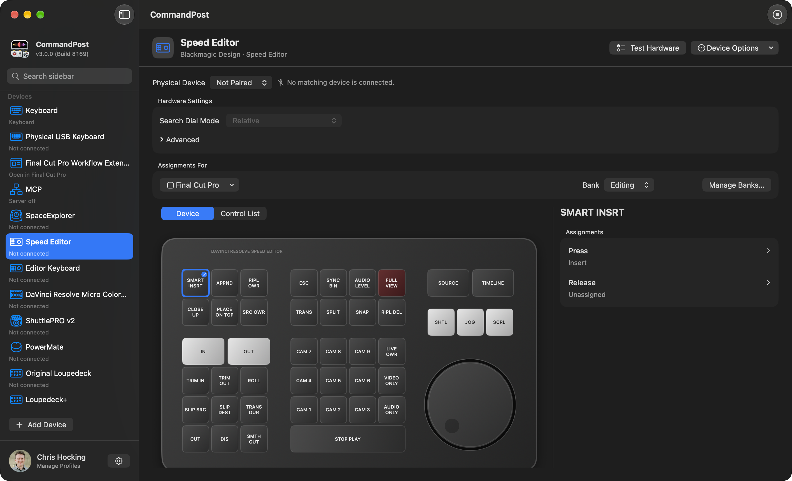{loading="lazy"}

---

### Used by Professionals

Rather than produce our own video tutorials - CommandPost is so popular that the community does it for us!

Watch this awesome introduction video by Arthur Moore on [YouTube](https://www.youtube.com/watch?v=2IkCYS9Svrw) on 14th September 2019:

[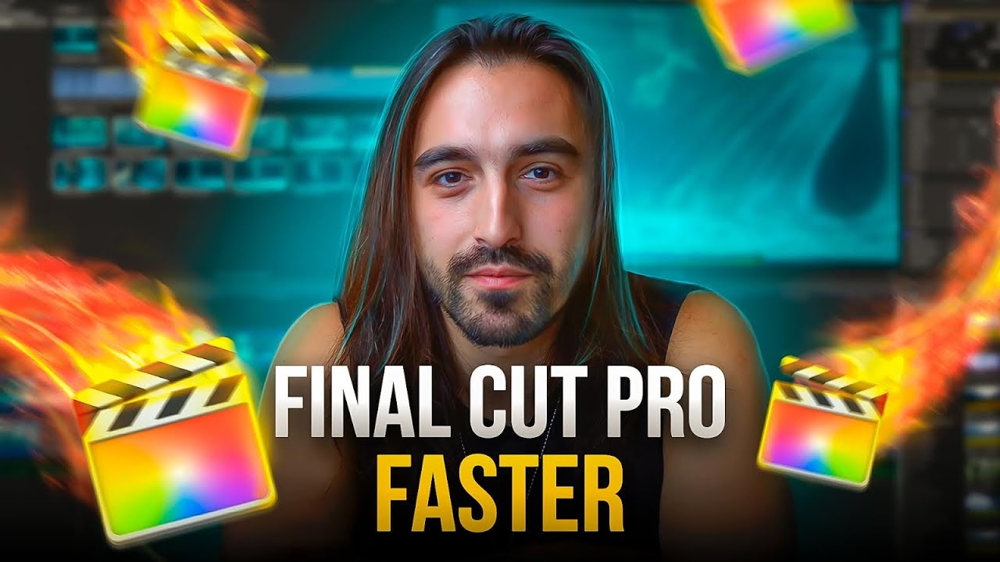{loading="lazy"}](https://www.youtube.com/watch?v=_tHdyD9TGCA)

---

### Built for Professionals

We developed new CommandPost v2 features especially for **[Apollo: Missions to the Moon](https://www.imdb.com/title/tt9782756/)**, edited by [David Tillman](https://twitter.com/davidtillman).

We've also built custom tools for Denmark’s second largest production company, **[Metronome Productions](http://www.fcp.co/final-cut-pro/news/867-metronome-celebrate-a-documentary-series-cut-on-fcpx-with-a-birthday-cake)**.

> _“ Titles to Keywords is a huge timesaver when editing complex scenes. Couldn’t live without it anymore. And directors love that every delivery of any line from any take is just one click away! ”_ 
> **[Knut Hake](http://www.knuthake.de)** - _Editor on Netflix's Blood Red Sky_

**Blood & Gold** was cut on Final Cut Pro and made extensive use of CommandPost v2's [Titles to Keywords Toolbox](https://commandpost.io/toolbox/titles-to-keywords/).

[{loading="lazy"}](https://www.youtube.com/watch?v=mqNzrsUerYw)

---

### Deeply integrated into Apple Creator Studio

**CommandPost v3** is designed to work deeply with every app in Apple's Creator Studio.

It has built-in actions for Final Cut Pro v13's new `fcptool`.

It has deep support of Final Cut Pro, and includes a powerful Workflow Extension.

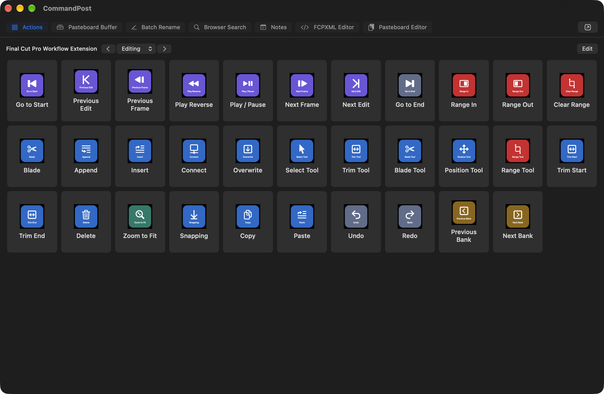{loading="lazy"}

---

### Designed with LLMs in mind

**CommandPost v3** has deep LLM support - with built-in support for the **Model Context Protocol (MCP)**.

Anything CommandPost can do... can be triggered by Claude, Codex, Copilot, Siri, or your local LLM.

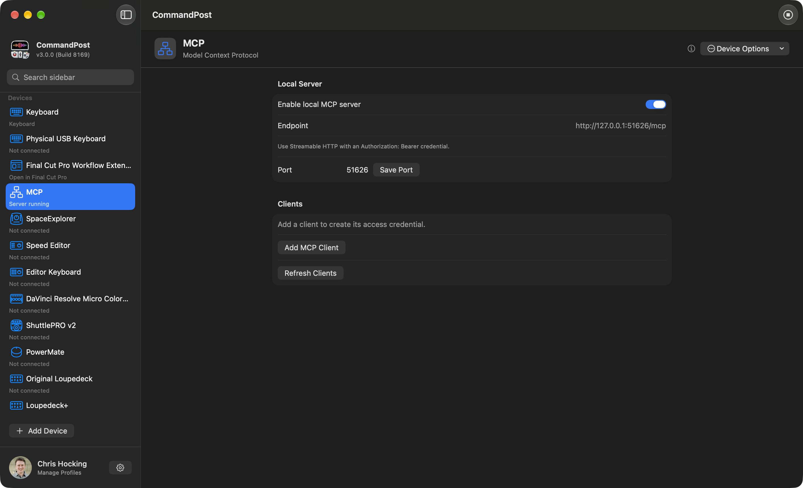{loading="lazy"}

---

### Where Technology Meets Creativity

> _“ CommandPost and FCP are so intertwined on my day to day that I see them as one app! ”_ 
> **[Marcos Castiel BFE](http://www.marcoscastiel.com/)** - _Editor on Netflix's Turn of the Tide_

CommandPost has been **built by filmmakers, for filmmakers**.

However, it's also used by developers, scientists and macOS power users all over the world to seriously speed up mundane tasks through powerful and customisable automation tools.

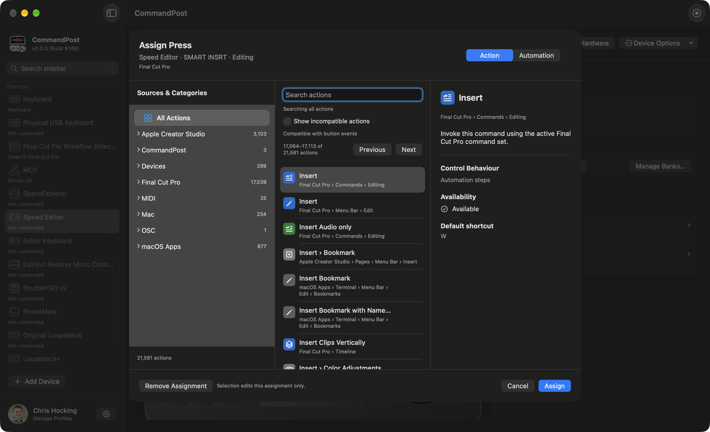{loading="lazy"}

---

### Experience Unparalleled Control

> _“ Command Post started as a FCPX utility but it goes further than that. You can use it to map almost any function to supported hardware devices to work with any app like a BMD Speed Editor and Avid Media Composer! ”_ 
> **[Marc Bach](https://www.interfacelab.tv)** - _Editor & Colourist_

CommandPost has deep support for a wide range of **control surfaces**.

It even brings back **[Razer](/commandpost-v2/control-surfaces/razer/)** keypad support to the Mac!

> _“ Chris's support is the best you will find anywhere on the planet. He was proactive and able to implement features for me on the spot. 5 STAR product 5 STAR support. ControllerMate is what I used to use. CommandPost is faster and easier. ”_ 
> **[Ross Batten](https://www.roscoaudio.com.au)** - _Senior Sound Designer (ProTools)_

You can basically control **ANYTHING** in Final Cut Pro with a huge range of control surfaces.

**[Tangent](/commandpost-v2/control-surfaces/tangent/)**, **[Monogram](/commandpost-v2/control-surfaces/monogram/)** and **[Loupedeck](/commandpost-v2/control-surfaces/loupedeck/)** all officially rely on CommandPost v2 for Final Cut Pro support.

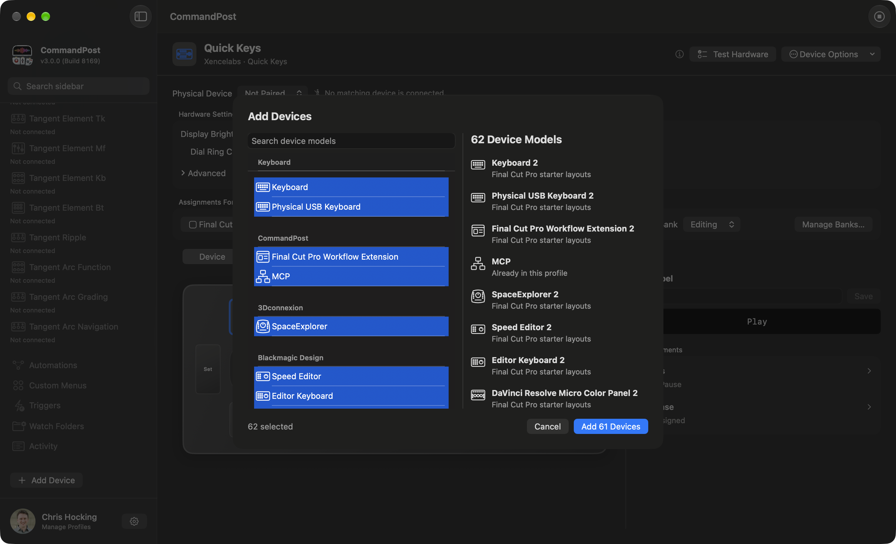{loading="lazy"}

---

### Powerful Search Console Redefines Navigation

> _“ Search Console is like Spotlight on steroids. It can quickly find and execute any obscure command, NLE and OS-wide, fire up keyboard makros (scripts), and especially, find and place Effects and Effect Templates, directly onto selected clips in my FCP timeline. It constantly saves me clicks. ”_ 
> **[Florian Duffe](https://florian-duffe.de/en/flow-en/)** - _Editor_

CommandPost has an insanely powerful **Search Console** that allows you to trigger all of CommandPost's actions.

Like Spotlight, this is accessible system-wide, and is also used to quickly assign actions to control surfaces buttons and knobs.

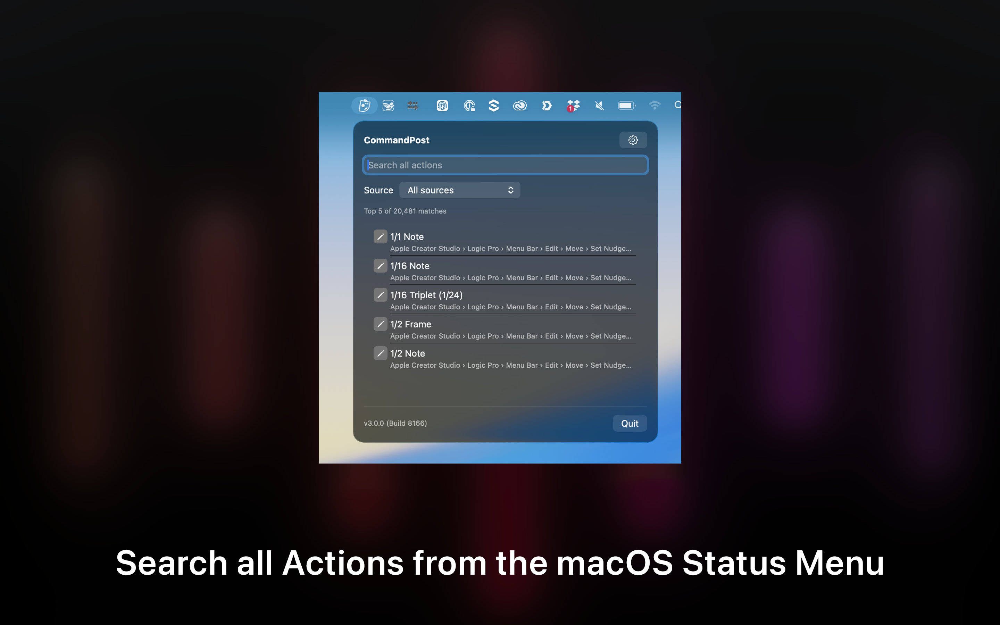{loading="lazy"}

---

### Revolutionise Your Workflow

> _“ CommandPost is so many things for so many people. For me it is a Final Cut Pro automation system that unlocks hidden features and uniquely supports advanced workflows. CommandPost’s secret weapon? Deep connections with the postproduction community which mean that it constantly improves as the needs of editors and post professionals evolve. ”_ 
> **[Alex ‘4D’ Gollner](https://alex4d.com)** - _Motion Template Creator_

CommandPost allows you to do things in Final Cut Pro that are otherwise not possible.

There's literally hundreds of actions in CommandPost for controlling Final Cut Pro in almost unlimited ways.

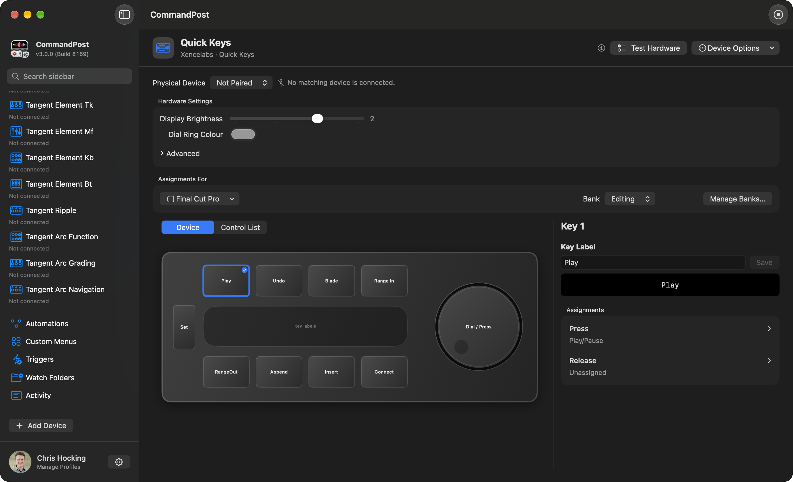{loading="lazy"}

---

### Say Goodbye to Complexity

> _“ Chris, you have no idea how helpful your Titles to Keywords toolbox has been on our latest production. Without the toolbox these 2-3 hour long timelines (around 900 keywords) would have been nearly impossible to tag with the FCP built in way. It's very long scenes with around 50 lines of text for all characters. ”_ 
> **[Sam Pluemacher](https://www.imdb.com/name/nm10223233/)** - _Assistant Editor on Netflix's Blood Red Sky_

CommandPost can do complex things with a single keystroke or button press.

It has some INSANELY powerful actions.

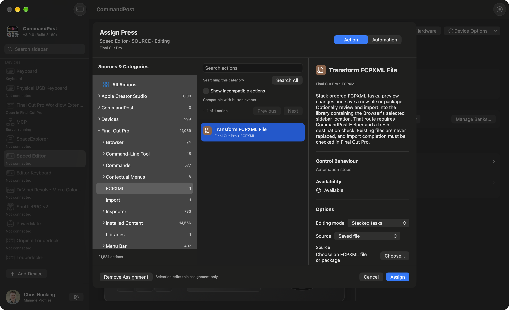{loading="lazy"}

---

### Diversify Your Creativity

> _“ As someone who doesn’t like clicking to do things, CommandPost makes my work much more likeable! ”_ 
> **[Oli Frost](https://olifro.st/)** - _Editor_

Whilst CommandPost was originally designed with Final Cut Pro in mind, it can actually control **ANY** Mac application.

The Search Console will also list all your [Keyboard Maestro](https://www.keyboardmaestro.com/) macros, macOS Shortcuts and even AppleScript's!

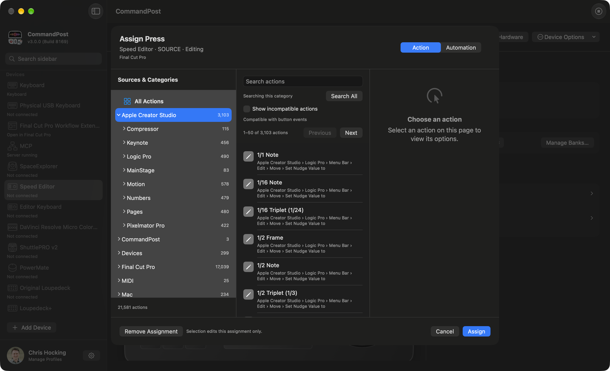{loading="lazy"}