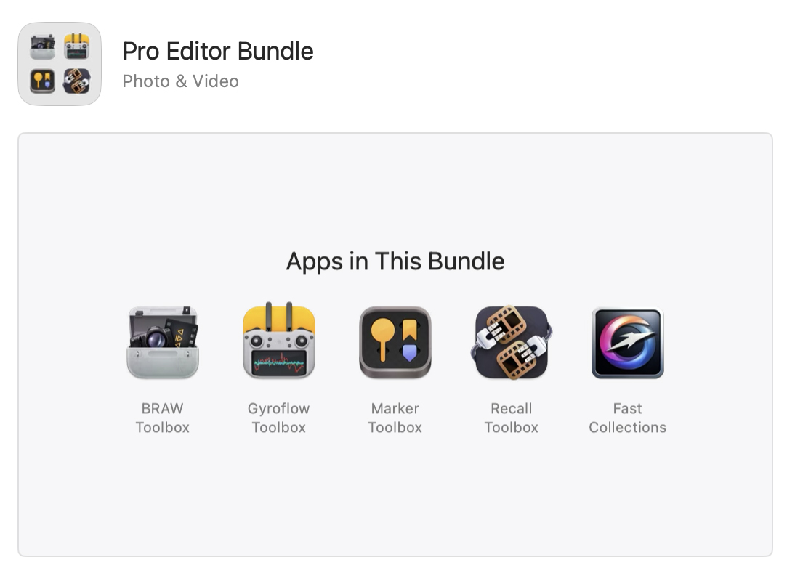
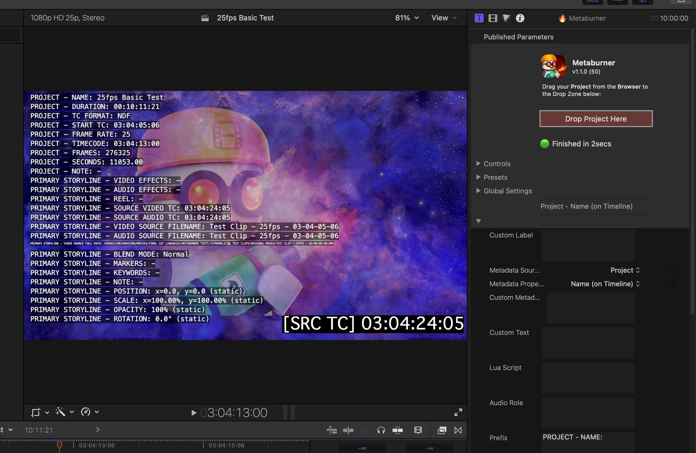

# Sponsor CommandPost

!!!tip
**CommandPost now requires at least ONE paid LateNite application installed from the Mac App Store.**\
\
The cheapest options are [ScriptStar](https://scriptstar.fcp.cafe), [Fast Collections](https://fastcollections.fcp.cafe), [Gyroflow Toolbox](https://gyroflowtoolbox.fcp.cafe), [LUT Robot](https://lutrobot.fcp.cafe), [News Import](https://newsimport.fcp.cafe), [Recall Toolbox](https://recalltoolbox.fcp.cafe) and [Transfer Toolbox](https://transfertoolbox.fcp.cafe) - all **USD$9.99**.\
\
You can find a list of all our applications on the [Mac App Store](https://apps.apple.com/au/developer/latenite-films-pty-ltd/id1652018641).
\
All our applications on the Mac App Store support Family Sharing, and offer a reduced price on the Apple School Manager for volume purchases.\
\
**CommandPost remains open source - and you can build it yourself.**\
\
You can read more about this decision on the [FAQ page](/faq/#why-is-commandpost-no-longer-free).
!!!

To help continue CommandPost to grow, evolve, and stay **open-source**, we offer several ways to sponsor CommandPost's continued development.

Our **preferred method** is [monthly GitHub Sponsorship](#github) - even if it's just a few dollars each month.

---

### Buy Me a Coffee

You can "buy us a coffee" here:

---

### Mac App Store

We also sell many useful paid Final Cut Pro tools on the Mac App Store such as:

- **BRAW Toolbox** allows you to import Blackmagic RAW files directly into Final Cut Pro without transcoding.
- **Gyroflow Toolbox** allows you to import Gyroflow Projects into Apple's Final Cut Pro.
- **Marker Toolbox** allows you to import Vimeo CSV, Wipster CSV, Dropbox Replay JSON & Email Comments into Final Cut Pro.

For only **USD$100** (save USD$49.95!), you can now buy [BRAW Toolbox](https://brawtoolbox.io), [Gyroflow Toolbox](https://gyroflowtoolbox.io), [Marker Toolbox](https://markertoolbox.io), [Recall Toolbox](https://recalltoolbox.io) & [Fast Collections](https://fastcollections.io) as a bundle!

Better yet, for an extra **USD$50**, you can also get [LUT Robot](https://lutrobot.pro) and [Capacitor](https://capacitor.pro) (save USD$119.93)!

The Mac App Store also supports **Complete My Bundle** - which credits customers for apps they’ve already purchased within a bundle. You only pay the balance for the remaining apps.

You can find the [**Pro Editor Bundle** on the Mac App Store](https://itunes.apple.com/us/app-bundle/id1717681153?mt=12).

You can find the [**Pro Editor Bundle v2** on the Mac App Store](https://itunes.apple.com/us/app-bundle/id1750813030?mt=12).

[!button text="Learn More" target="blank" variant="info"](https://fcp.cafe/latenite/)

---

### Metaburner

We also sell Metaburner on FxFactory - however, this doesn't "unlock" CommandPost (only our Mac App Store apps do).

You can learn more and download a free trial via the [Metaburner website](https://metaburner.pro).

---

### PayPal

Alternatively, you can also make a contribution via **[PayPal](https://www.paypal.com/cgi-bin/webscr?cmd=_s-xclick&hosted_button_id=HQK87KLKY8EVN)**.

If you're in Australia, we can also generate a **tax invoice** with GST for you - just [contact us](mailto:support@latenitefilms.com?subject=CommandPost).

---

### GitHub

To help continue CommandPost to grow, evolve, and stay completely **free and open-source**, we offer the ability to sponsor CommandPost directly through GitHub.

You can do **one-off** or **monthly** payments.

GitHub is a safe and secure developers platform used by over **73 million users** worldwide.

- Sponsor CommandPost on GitHub [here](https://github.com/sponsors/commandpost).

You can also sponsor CommandPost's individual developers here:

- Sponsor Chris on GitHub [here](https://github.com/sponsors/latenitefilms).
- Sponsor David on GitHub [here](https://github.com/sponsors/randomeizer).

Thanks team!

---

### Current GitHub Sponsors

Thanks to all these amazing people for supporting CommandPost!

 [davvidavvi](https://github.com/davvidavvi)

 [elzotto](https://github.com/elzotto)

 [florian-duffe](https://github.com/florian-duffe)

 [funwithstuff](https://github.com/funwithstuff)

 [ivandepaz-editor](https://github.com/ivandepaz-editor)

 [jbrunson83](https://github.com/jbrunson83)

 [lamer40](https://github.com/lamer40)

 [MarcosCastiel](https://github.com/MarcosCastiel)

 [NigelRios](https://github.com/NigelRios)

 [samplue](https://github.com/samplue)

 [thermidorthelobster](https://github.com/thermidorthelobster)

 [wtembundit](https://github.com/wtembundit)

 [Yuvalorr](https://github.com/Yuvalorr)

You can join this list by sponsoring CommandPost on [GitHub](https://github.com/sponsors/commandpost) today!

---

